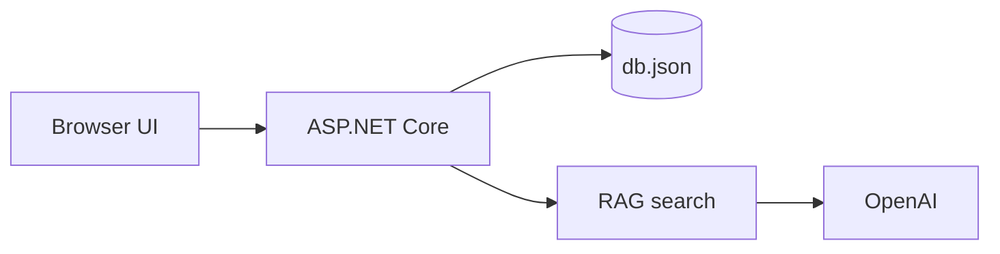

# Roofing CRM — map-based lead identification

## Overview

**What it is:** A map-first CRM that helps roofing sales find leads near a chosen location—by aging roof, open permit, radius, and filters—and save them for follow-up.

**How it’s built:**

- **Browser:** Map, filters, and lead list run in JavaScript over bundled demo properties (`app.js`).
- **Server (ASP.NET Core):** `POST/GET/PUT/DELETE /api/leads` reads and writes saved leads in `data/db.json`.
- **Ask AI:** The UI sends your prompt plus map center and radius to `POST /api/search/prompt`; the server embeds the question, retrieves matching property facts from an in-memory index, and returns property IDs for the map to highlight—no separate property database.

---

## Architecture

One **ASP.NET Core** app serves the static UI and two APIs. The **map and filters** run in the browser over demo data in `wwwroot/app.js`. **Saved leads** go to `data/db.json`. **Ask AI** uses seeded facts in `RoofingKnowledgeSeed`, an in-memory vector index built at startup, and OpenAI for embeddings and a short grounded answer.




**Design choices**

- Database - in-memory JSON file.
- RAG - retrieve top‑K similar docs from in-memory vector store.
- Models: `text-embedding-3-small`, `gpt-4o-mini` (see `appsettings.json`).

---

## Setup and run instructions

### Prerequisites

- [.NET 10 SDK](https://dotnet.microsoft.com/download)
- Valid **OpenAI API key** with access to the configured chat and embedding models

### Install and run

```bash
git clone <your-repo-url> roofing-crm

cd roofing-crm

dotnet run --project roofing-crm.csproj
```

Open the URL shown in the console (default profile: **http://localhost:5271**).

**NOTE:** Wait for log lines indicating the vector index is ready before using **Ask AI**.

## How to verify it works

Default demo data is **Travis County / Austin** (`MOCK_PROPERTIES` in `wwwroot/app.js`).

### Sample API inputs / outputs

**RAG search**

```bash
curl -s -X POST http://localhost:5271/api/search/prompt \
  -H "Content-Type: application/json" \
  -d "{\"prompt\":\"open roofing permits older than five years\",\"latitude\":30.2672,\"longitude\":-97.7431,\"radiusMiles\":5}"
```

Expected (shape): JSON with `matchedProperties` (array of `propertyId`, `address`, `latitude`, `longitude`), `answer` (string), and `retrievedContext` (string array). Example property id for a long-open permit in demo data: `"p5"` (9901 Brodie Ln).

**Create CRM lead** (normally done from UI; API for verification)

```bash
curl -s -X POST http://localhost:5271/api/leads \
  -H "Content-Type: application/json" \
  -d "{\"propertyId\":\"p1\",\"address\":\"1204 Barton Springs Rd\",\"city\":\"Austin\",\"latitude\":30.2634,\"longitude\":-97.7712,\"roofAgeYears\":22,\"permitOpen\":true,\"permitOpenYears\":6,\"permitStatus\":\"Open\",\"contractorName\":\"Lone Star Roofing LLC\",\"bbbRating\":\"B+\",\"leadSignals\":[\"aging\",\"permit\"]}"
```

Expected: HTTP **201** with JSON body including `id`, `status`: `"New"`. Repeating the same `propertyId` → HTTP **409**.

**List leads**

```bash
curl -s http://localhost:5271/api/leads
```

Expected: JSON array of saved leads.

### Quick UI smoke path (≈2 minutes)

1. `dotnet run` with `OPENAI_API_KEY` set → open http://localhost:5271
2. Confirm lead candidates appear at default center and 5 mi radius
3. Open **9901 Brodie Ln** → verify permit 8 yr open, contractor, BBB **C**
4. **Save to CRM** → drawer shows one lead
5. Run Ask AI sample prompt → list/map narrows to matching properties

---