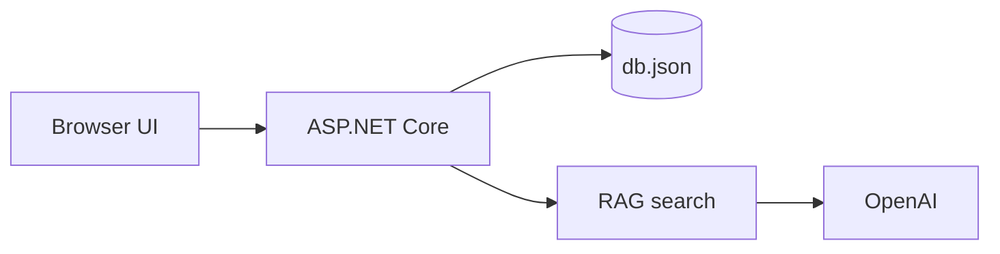

# Roofing CRM

[**Live app**](https://roofingcrm-gge5f4h4f9c6ecem.westus3-01.azurewebsites.net/) · [**Demo video**](https://www.loom.com/share/c450afb1118c42cf8b31b580db7b7010)

## Overview

**What it is:** A map-first CRM that helps roofing sales find leads near a chosen location—by aging roof, open permit, radius, and filters—and save them for follow-up.

**How it’s built:**

- **Browser:** Map, filters, and lead list run in JavaScript over bundled demo properties (`app.js`).
- **Server (ASP.NET Core):** `POST/GET/PUT/DELETE /api/leads` reads and writes saved leads in `data/db.json`.
- **Ask AI:** The UI sends your prompt plus map center and radius to `POST /api/search/prompt`; the server embeds the question, retrieves matching property facts from an in-memory index, and returns property IDs for the map to highlight—no separate property database.

---

## Architecture

One **ASP.NET Core** app serves the static UI and two APIs. The **map and filters** run in the browser over demo data in `wwwroot/app.js`. **Saved leads** go to `data/db.json`. **Ask AI** uses seeded facts in `RoofingKnowledgeSeed`, an in-memory vector index built at startup, and OpenAI for embeddings and a short grounded answer.



**Design choices**

- Database - in-memory JSON file.
- RAG - retrieve top‑K similar docs from in-memory vector store.
- Models: `text-embedding-3-small`, `gpt-4o-mini` (see `appsettings.json`).

---

## Setup and run instructions

### Prerequisites

- [.NET 10 SDK](https://dotnet.microsoft.com/download)
- Valid **OpenAI API key** with access to the configured chat and embedding models

### Install and run

```bash
git clone https://github.com/KakhaberTezelashvili/roofing-crm

cd roofing-crm

dotnet run
```

Open the URL shown in the console (default profile: **http://localhost:5271**).

**NOTE:** Wait for log lines indicating the vector index is ready before using **Ask AI**.

### Quick UI smoke path (≈2 minutes)

1. Open [Live app](https://roofingcrm-gge5f4h4f9c6ecem.westus3-01.azurewebsites.net/) or run locally (`dotnet run` with `OPENAI_API_KEY` → http://localhost:5271)
2. Use filters and see how map adjusts according to it's values.
3. Focus any lead and explore it's details.
4. Save selected lead to CRM.
5. Run Ask AI sample prompt → list/map narrows to matching properties

---
